# mst2-carplay-vc

This patch brings CarPlay media information including title, artist, album, playback progress, shuffle status and cover art to the cluster instead of just showing the generic "Apple CarPlay" text.

It also enables a "Share to External Maps" button within navigation apps to directly import the addresses into the internal Navi.

Supports HMI version H29.xxx.xx with FW 04xx or higher (see [Compatibility](#compatibility)).

Compatible with Virtual Cockpit and non-VC clusters (ZR + PQ).

Works both on wired USB-cable and wireless connection via third-party dongles.


|                           Stock HU                           |
| :----------------------------------------------------------: |
| 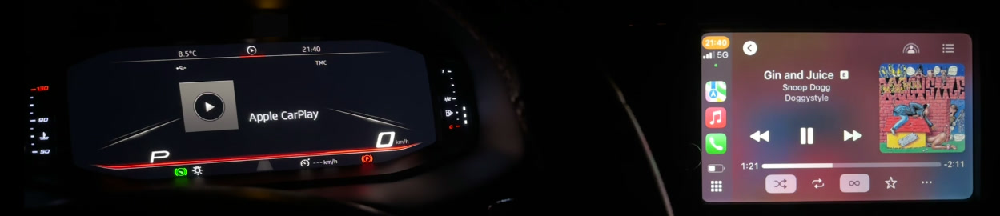 |

|                          Patched HU                          |
| :----------------------------------------------------------: |
| 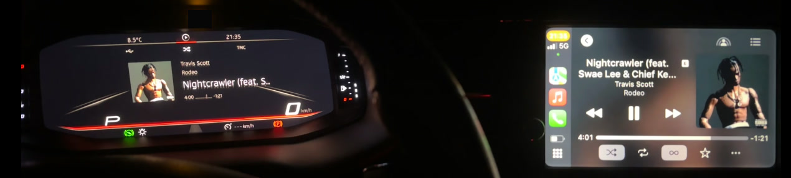 |

> [!IMPORTANT]
> **Updating from v1:** Remove v1 completely first, patch and menu, then continue with v2. All steps under [Updating from v1](#updating-from-v1).

## Compatibility

> [!CAUTION]
>
> - Only supports MST2 TechniSat ZR/PQ (MIB2 STD)
> - Does NOT work with:
>   - MST2 Delphi (MIB2 STD)
>   - MHI2 Harman (MIB2 High)

### Supported head units

| HMI version | Firmware                                                     | Unit   | Brand           | Region     | v2.0 | v1   |
| ----------- | ------------------------------------------------------------ | ------ | --------------- | ---------- | ---- | ---- |
| H29.344.66  | 0512, 0514, 0515, 0516                                       | ZR     | Seat            | EU         | ✅    | ✅    |
| H29.319.120 | 0480                                                         | ZR, PQ | Seat, Skoda, VW | EU         | ✅    | ❌    |
| H29.319.93  | 0468, 0469, 0472, 0475, 0477, 0478, 0480                     | ZR, PQ | Seat, Skoda, VW | EU, NA, CN | ✅    | ❌    |
| H29.319.76  | 0475, 0478, 0480, 0605                                       | ZR, PQ | Seat, Skoda, VW | EU, NA     | ✅    | ❌    |
| H28.28.x    | 0346, 0351, 0353, 0356, 0359, 0360, 0361, 0363, 0366, 0367, 0368, 0369, 0370 | ZR, PQ | Seat, Skoda, VW | EU, NA, CN | ❌    | ❌    |
| H25.14.x    | 0240, 0241, 0245, 0247, 0248, 0249, 0252, 0253, 0254, 0255, 0388, 0604 | ZR, PQ | Seat, Skoda, VW | EU, NA, CN | ❌    | ❌    |
| H24.x       | 0135, 0137, 0138                                             | ZR, PQ | Skoda, VW       | EU, RoW    | ❌    | ❌    |

- RoW region isn't supported yet
- Older HMI versions (H28 and older) and unknown variants aren't supported
- Audi and VW with MST2 Delphi or MHI2 Harman units aren't supported

> [!TIP]
> Only H29.344.66 is tested in car. Other variants and regions have only been checked against dumps.
>
> On untested units, enable telnet access once before you install (see [Requirements](#requirements)), so you still have access via console in case of an emergency.

> [!IMPORTANT]
>
> Partly vibecoded project. Not responsible for any damages. Use at your own risk. More in the [disclaimer](#license-and-disclaimer) section at the bottom.

## Features

| Unit         | Navi    | Region | Media info |  Cover  | Progress | Shuffle | Share to External Maps |
| ------------ | ------- | ------ | :--------: | :-----: | :------: | :-----: | :--------------------: |
| ZR           | with    | EU, NA |     ✅      |    ✅    |    ✅     |    ✅    |           ✅            |
| ZR           | without | all    |     ✅      |    ✅    |    ✅     |    ✅    |           ❌            |
| ZR           | any     | CN     |     ✅      |    ✅    |    ✅     |    ✅    |           ❌            |
| PQ           | any     | all    |     ✅      |    ❌    |    ❌     |    ❌    |           ❌            |
| Type unknown | any     | all    |     ✅      | ✅ if ZR | ✅ if ZR  | ✅ if ZR |           ❌            |

### Media info

- Takes about 1 - 2 seconds to appear on the cluster
- Can be any media source, as long as it's displayed as a song
- No animations for fading songs

### Cover

- Takes about 3 - 6 seconds to appear on the cluster
- The cover doesn't change if the next song has the exact same cover, e.g. for albums
- Displays the default blank cover for songs without a cover

### Playback progress

- Updates every second, elapsed and remaining time always change together
- Shows how much time has elapsed and how much is still left
- Uses the fourth row, which is normally empty and only used for longer song titles
- Normal length tracks look like this: `1:05 .....|............ -2:15`
- Live sets or tracks over an hour look like this: `0:12:30 .|.......... -1:07:30`

### Shuffle status

- Takes about 2 - 3 seconds to appear on the cluster
- Mirrors the shuffle status from media apps

### Navigation

- In CarPlay map apps (only Apple Maps supports it afaik) it enables a button that sends the address or destination to the internal HU navi
- This is a one-time hand-off of the destination from CarPlay to the HU, not true turn by turn
- A warning in CarPlay might appear if you cancel the route on the HU
  - `"Unable to Send: Timed out waiting for the connected car to respond."`
  - This is harmless and can be safely ignored

|                   "Share to External Maps"                   |             Address imported into internal Navi              |
| :----------------------------------------------------------: | :----------------------------------------------------------: |
| 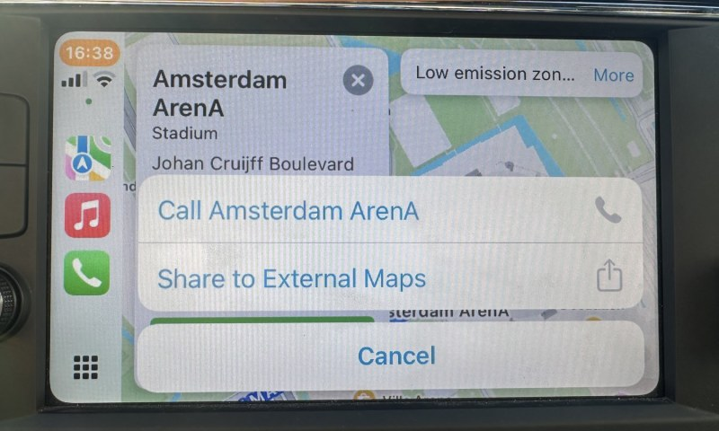 | 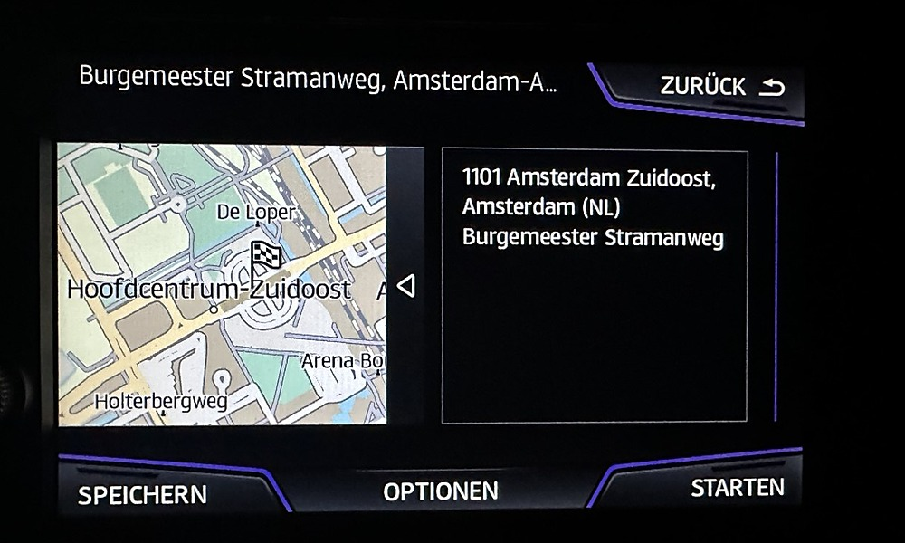 |

## Requirements

- [Compatible head unit](#compatibility)
- Developer Mode / Green Engineering Menu activated
- [MIB STD2 Toolbox](https://github.com/olli991/mib-std2-pq-zr-toolbox) installed on your HU
- [MIB STD2 Toolbox](https://github.com/olli991/mib-std2-pq-zr-toolbox) files on your sd-card
- SD-card formatted to FAT32, cluster size 4096 bytes
- `Activate permanent telnet and console access` enabled once in GEM under /mibstd2-toolbox/network
  - In case of emergency or anything going wrong

> [!NOTE]
>
> *Optional, only for manual [telnet method](#install-via-telnet):*
>
> - D-Link DUB-100 Ver.D1 Ethernet to USB adapter, or a compatible converted adapter
> - Laptop

## How to install

### Prepare the sd-card

Download `mst2-carplay-vc-v2.0.zip` from the [latest release](https://github.com/xPaiiN/mst2-carplay-vc/releases/latest), extract it and copy `custom/` to the sd-card along with the toolbox files. 

**The sd-card should look like this (only showing required files for the patch):**

```text
sd/
└── custom/
    ├── greenmenu/
    │   ├── mibstd2-carplay-vc.esd
    │   └── scripts/
    │       ├── cpvc_install.sh
    │       ├── cpvc_install_debug.sh
    │       ├── cpvc_lib.sh
    │       ├── cpvc_logs.sh
    │       ├── cpvc_state.sh
    │       └── cpvc_uninstall.sh
    └── java/
        ├── cpvc-bridge.jar
        └── cpvc-cover-elf
```

> [!TIP]
>
> - To reboot the HU, hold the power/volume knob for about 12 seconds, until you see the boot logo again
> - With 2 sd-cards inserted, the slots often swap places after a HU reboot:
>   - sd-slot 1 becomes `/media/mp001` and sd-slot 2 becomes `/media/mp000`
> - No sd-card needed for `Status` and `Uninstall`
>   - `Install` and `Collect Logs` need the sd-card with `custom/`
> - The scripts back up the original `runHMI.sh` and `iap2.cfg`
>   - HU:
>     - `/tsd/hmi/runHMI.sh.bak` 
>     - `/tsd/var/sal/carplay/iap2.cfg.bak`
>   - SD:
>     - `backup/carplay-vc/runHMI.sh`
>     - `backup/carplay-vc/iap2.cfg`
>   - `Uninstall` uses the backup on the HU first, the sd-card only if that one is missing

> [!IMPORTANT]
> If you get an error, do NOT reboot instantly if anything was changed. Look up [Error codes](#error-codes) for what to do.

### Install via GEM (recommended)

- Insert the prepared sd-card in any slot
- Open GEM
- browse to /mibstd2-toolbox/customization/greenmenu
- `Copy custom Green Engineering Menu screens and scripts to unit`
- Close and re-open GEM when done
- browse to /mibstd2-toolbox/customization/carplay-vc
- `Install`
- Reboot if everything ok
- Enjoy :)
- Feel free to share your results in this [discussion](https://github.com/xPaiiN/mst2-carplay-vc/discussions/1) <3

### Install via telnet

Requires the optional parts listed under [Requirements](#requirements).

Set this network config on your laptop's network interface:

| Network            | Value                    |
| ------------------ | ------------------------ |
| IPv4 address       | `192.168.1.10`           |
| Subnet mask        | `255.255.255.0` or `/24` |
| Gateway (optional) | `192.168.1.4`            |

- Plug the USB to LAN adapter in any USB slot of the HU
- Connect with any telnet client (e.g. PuTTY, MobaXterm or Terminal):

| Telnet | Value         |
| ------ | ------------- |
| Host   | `192.168.1.4` |
| Port   | `23`          |

- Login:
  - user `root`
  - password `root`
- Locate the sd-card path
  - sd-slot 1 is `/media/mp000`
  - sd-slot 2 is `/media/mp001`
  - Replace the `x` with your actual sd-slot
- Run the install script:

```sh
sh /media/mp00x/custom/greenmenu/scripts/cpvc_install.sh
```

- Reboot if everything ok
- Enjoy :)
- Feel free to share your results in this [discussion](https://github.com/xPaiiN/mst2-carplay-vc/discussions/1) <3

## How to uninstall

> [!NOTE]
>
> - HU will be restored back to stock state
>   - `runHMI.sh` and `iap2.cfg` restored from backups (preferring HU backups) and patch files removed
> - The menu will not be removed from GEM
>   - To remove it too, run `Restore Green Engineering Menu from backup` in GEM under /mibstd2-toolbox/customization/greenmenu and then reboot

### Uninstall via GEM

- Open GEM
- browse to /mibstd2-toolbox/customization/carplay-vc
- `Uninstall`
- Reboot if everything ok

### Uninstall via telnet

Connect like in [Install via telnet](#install-via-telnet), then run this uninstall script:

```sh
sh /media/mp00x/custom/greenmenu/scripts/cpvc_uninstall.sh
```

## How to troubleshoot

Only needed for reproducing issues (for errors, look up [Error codes](#error-codes)).

- Open GEM
- browse to /mibstd2-toolbox/customization/carplay-vc
- `Install (debug, only if asked)`
  - on an already patched unit, this just turns the debug logs on
- Reboot if everything ok
- Reproduce the error
- `Collect Logs`, it writes a folder on the sd-card: `cpvc-logs-2.0-<date>`
- On your PC clean it with [cpvc_clean_logs.py](https://github.com/xPaiiN/mst2-carplay-vc/blob/main/tools/cpvc_clean_logs.py), open an issue and attach the logs
- To turn debug off again: `Uninstall`, reboot, `Install`, reboot

> [!WARNING]
> The collected logs contain sensitive data like VIN, serial numbers, location and phone name. Clean them with `cpvc_clean_logs.py` before you create an issue and attach them.
>
> More details for debugging in the [wiki](https://github.com/xPaiiN/mst2-carplay-vc/wiki/Debugging).

## Updating from v1

v1 has to be removed completely with its own menu first. If v1 is still installed but its menu is gone, download the v1 zip for your variant from [v1.0.0 (legacy) release](https://github.com/xPaiiN/mst2-carplay-vc/releases/tag/v1.0.0), copy its `custom/` to the sd-card. Then remove it like this:

- Insert the sd-card in any slot
- Open GEM
- browse to /mibstd2-toolbox/customization/greenmenu
- `Copy custom Green Engineering Menu screens and scripts to unit`
- Close and re-open GEM when done
- browse to /mibstd2-toolbox/customization/carplay-vc (v1 menu)
- `Disable + Cleanup`
- Reboot
- Open GEM again
- browse to /mibstd2-toolbox/customization/greenmenu
- `Restore Green Engineering Menu from backup`
- Reboot
- Put the sd-card back into your PC and delete all v1 files from the sd-card:

```text
sd/
├── custom/
│   ├── greenmenu/
│   │   ├── carplay-vc.esd
│   │   └── scripts/
│   │       ├── cpvc_activate.sh
│   │       ├── cpvc_activate_debug.sh
│   │       ├── cpvc_common.sh
│   │       ├── cpvc_copy_logs.sh
│   │       ├── cpvc_deactivate.sh
│   │       └── cpvc_status.sh
│   └── java/
│       ├── cpvc-cover-bridge
│       └── mst2-carplay-vc-<variant>-v1.jar
└── method2-console/   (only if you used the telnet method)
```

- Then continue with v2.0

## Error codes

Every error has a code and says if anything was changed. If it says one of these, the HU is fine and it is safe to reboot:

- `No changes were made`
- `All changes were undone`
- `The unit was not changed`

> [!CAUTION]
>
> - `Undo incomplete, the unit is partly patched`: Do NOT reboot
>   - Run `Uninstall` first
>   - If it could not be restored with the scripts, restore it manually via telnet from the backups before you reboot
> - A damaged `runHMI.sh` (E01, E24, D08) is more critical than a broken `iap2.cfg`
>   - A broken `iap2.cfg` only affects CarPlay, a broken `runHMI.sh` softbricks your HU
> - As long as you follow everything correctly, there should be no problems.

**Install errors**

| Code          | Message                                        | What to do                                                   |
| ------------- | ---------------------------------------------- | ------------------------------------------------------------ |
| E01           | runHMI.sh is missing or damaged                | Do NOT reboot. Run `Uninstall` or manually restore the file from your backup |
| E02           | this unit is not supported                     | The unit variant is unknown. Open an issue and attach `sd/custom/report/` |
| E05           | this firmware is not supported yet             | Open an issue and attach `sd/custom/report/`                 |
| E06           | no SD card found                               | Insert the SD-card with the patch and try again              |
| E07           | the package on the SD card is incomplete       | Copy `custom/` from the zip again                            |
| E08           | mst2-carplay-vc v1 is installed                | Remove v1 completely first, see [Updating from v1](#updating-from-v1) |
| E09           | an older patch is installed                    | Remove it with its own menu first                            |
| E10           | iap2.cfg is not original                       | The file has an unexpected format, another patch may have replaced it. Open an issue and attach logs |
| E11           | old install found                              | Marks of an earlier install, or another patch already set the same options. `Uninstall`, reboot, `Install` |
| E12, E14, E26 | cannot write to the unit                       | Reboot and try again                                         |
| E13           | cannot clean up an old install                 | Reboot and try again                                         |
| E15           | iap2.cfg could not be prepared                 | Reboot and try again                                         |
| E16           | iap2.cfg does not exist yet                    | CarPlay never ran. Connect it once, then install             |
| E17, E18      | backup of runHMI.sh / iap2.cfg failed          | Check that the unit storage isn't full                       |
| E19, E21      | iap2.cfg could not be patched / check failed   | Open an issue and attach logs                                |
| E20           | iap2.cfg could not be written                  | Storage may be full or read-only                             |
| E22, E23      | copy failed (cpvc-bridge.jar / cpvc-cover-elf) | Copy `custom/` again, then check that the unit storage isn't full |
| E24           | runHMI.sh could not be patched                 | Do NOT reboot. Check if runHMI.sh is valid before trying again. |
| E25           | menu could not be installed                    | Reboot and run `Install` again. If it fails again, open an issue with logs |

**Uninstall errors**

| Code     | Message                                        | What to do                                                   |
| -------- | ---------------------------------------------- | ------------------------------------------------------------ |
| D01      | an older patch is installed                    | Remove it with its own menu first                            |
| D02      | mst2-carplay-vc v1 is installed                | Remove v1 completely first, see [Updating from v1](#updating-from-v1) |
| D04      | no valid backups found                         | Restore the files from `backup/carplay-vc/` on the SD-card manually via telnet |
| D05      | iap2.cfg state unknown                         | Open an issue and attach logs                                |
| D06, D07 | cannot write to the unit                       | Reboot and try again                                         |
| D08, D09 | runHMI.sh / iap2.cfg could not be restored     | Do NOT reboot. Run `Uninstall` or manually restore the file from your backup. Then run `Collect Logs` |
| D10, D11 | patch files / state files could not be removed | Run `Uninstall` again                                        |

**Collect Logs errors**

| Code | Message                     | What to do                                   |
| ---- | --------------------------- | -------------------------------------------- |
| L01  | no SD card found            | Insert the SD-card with the patch            |
| L02  | cannot write to the SD card | Check that the card isn't full or locked     |
| L03  | logs incomplete             | The folder is still usable, attach it anyway |

## Successfully tested with

MST2:

- HU: MST2 TechniSat ZR
- Part Number: 5F0 035 877 (not patchable with SD-card method, only USB2HSD or eMMC)
- Region: EU
- Firmware: 0516
- HMI version: H29.344.66
- HW Version: H50x
- Seat Leon 5F

Cluster Virtual Cockpit:

- Part Number 5F0 920 790 A
- Software Version: 1701

Devices:

- iPhone 14 Pro iOS 18.7.2 (main)
- iPhone 15 Pro iOS 27.0.1
- iPhone 11 Pro iOS 16.6.1

Music sources:

- Apple Music
- Spotify
- YouTube sideloaded
- Local audio files (via iOS Files app)

Wireless adapter:

- Carlinkit 5.0
- Carlinkit 3.0

---

Shoutout to [@omonob](https://github.com/omonob) for helping out and testing cn-region on v1 <3

MST2:

- HU: MST2 TechniSat PQ
- Part Number: 5C0 035 682 G
- Region: CN
- Firmware: 0478
- HW Version: H32

MHI2.5:

- HU: MHI2 Harman
- Part Number: 3EB 035 048
- Region: CN
- Firmware: 0841
- HW Version: H55
  - Note: MHI2 version is in the works.

---


## Development

How the patch works and what it changes is in the [wiki](https://github.com/xPaiiN/mst2-carplay-vc/wiki).


### Stuff

I originally made this patch because it annoyed me that there was no stock implementation. I also wanted to see how far I could push AI without writing a single LOC myself.

Originally I started the research by myself and only used AI to write the bridge and stuff. From there progress evolved pretty quickly. I rewrote chunks of the scripts and some parts of the cover art logic for v2.0.0.

Softbricked the HU ~~twice~~ three times along the way. First from messing with `cpu.conf`, second time from an empty `runHMI.sh` on reboot, and third because `cpu.conf` pointed to files that did not exist, so HMI could not boot at all.

It turned into a bit more iterations than I expected. Somewhere around ~~300~~ 500 patch builds and about ~~120~~ 250 trips to the car to test them, since there is no safe way to work on these units and every test means copying it over, rebooting and checking. And I dont have a test bench unit.

Also I wrote this readme by myself tho, no AI used

### To-Do (internally, not implemented)

- [ ] update button that installs the newest version
- [ ] pq: confirm media info is working
- [ ] older hmi sw h28 (fw 03xx) support
- [ ] row support
- [ ] delphi support
- [x] media integration
  - [x] title, artist, album
    - [x] changing within 0-1 seconds
    - [x] fix that songtext doesnt get cleared sometimes
  - [x] cover art
    - [x] changing within 3-6 seconds
    - [ ] cover art fixes: even more faster and stable
    - [x] no blank cover in between song switches
    - [x] cover stays if next or previous song has same cover (for album listens)
    - [x] fix that covers get stuck indefinitely rarely
    - [x] fix that songtext gets empty after 120 seconds but covers stay, while calling
  - [x] display shuffle icon if on (no interest in repeat icon as I don't use this ever and it also collides with shuffle on my hu)
  - [x] replace old "1:05 / 3:20" progress bar with a more realistic progress bar "1:05 .....|............ -2:15"
  - [x] ambientelight from dominant cover art color
- [x] telephony integration
  - [x] recents list
    - [x] date and time stamps
    - [x] callable from vc with buttons
  - [ ] ~~favorite list~~ not possible
  - [x] call duration (not possible natively, only as text behind caller name)
  - [x] mute
    - [x] fix mute state on vc persists through hang up to next call
  - [x] hold
  - [ ] ~~caller picture~~ not possible
  - [x] battery state
  - [x] native carplay icon before "Apple CarPlay" placeholder text
    - [ ] could be replaced with own phone name, but only without native carplay icon
  - [x] ~~removed~~ re-implemented call bypass implementation ~~from main patch as it really serves no purpose right now~~
- [x] custom carplay config menu replacing fulllink config menu
- [x] resync library to throttle location packet spam from hu to iphone
  - [x] avoids random crashes successfully, more stable than stock without patch
- [x] display scaling / resolution (requires iOS 26+)
- [x] front pdc view not blocking carplay with full blackscreen
- [x] true turn by turn route guidance with apple style lane guidance and side streets
- [x] media info instead of "USB" on hu screen
- [x] real phone names instead of placeholder "iPhone" device name
- [x] volume number in the volume popup (for seat leon specifically)
- [x] dolby atmos spatial audio for carplay
  - [x] for 2 channel can amp to 5.1 matrix
  - [ ] fixes for 5.1 for most amp and no external amp
- [x] navi implementation
  - [x] true turn by turn
  - [x] route guidance
  - [x] eta
  - [x] lane guidance
  - [x] sidestreets
  - [ ] highway fixes
  - [ ] more support for other countries than germany
    - [ ] localization
  - [ ] route to internal maps via most? (or bap?)
- [ ] mhi2 support (no eta yet for release)
- [x] fix that scripts sometimes freeze
- [x] fix that scripts wont accept jars
- [x] fix that scripts chose the wrong region
- [x] cleanup scripts
- [x] make scripts delete /tsd/var/carplayvc after uninstalling

### Sources

- [olli991/mib-std2-pq-zr-toolbox](https://github.com/olli991/mib-std2-pq-zr-toolbox)
  - scripts to dump mst2 filesystem
  - java patch architecture and script implementation
  - custom GEM menu entry
  - console access
  - +much more
- [adi961/mib2-android-auto-vc](https://github.com/adi961/mib2-android-auto-vc)
  - bridge architecture
- [luka-dev/mib2q-carplay-rgi](https://github.com/luka-dev/mib2q-carplay-rgi)
  - java build toolchain `zulu8.78.0.19-ca-jdk8.0.412` with `jclFoundation11.jar` and `j9jce.jar` bootclasspath stubs
  - build pattern: `javac -source 1.4 -target 1.4 -bootclasspath jclFoundation11.jar`
- [luka-dev/jxe2jar](https://github.com/luka-dev/jxe2jar)
  - for converting MIBHMI.jxe to .jar
- [Mr-MIBonk/M.I.B._More-Incredible-Bash (discussion #93)](https://github.com/Mr-MIBonk/M.I.B._More-Incredible-Bash/discussions/93)
  - for confirming the NavActiveIgnore patch approach
- [grajen3/mib2-lsd-patching](https://github.com/grajen3/mib2-lsd-patching)
  - MHI2 research
- [drive2.ru write-up](https://www.drive2.ru/l/647383926293153054/)
  - for MIBHMI.jxe patch approach through tsd.mibstd2.hmi.ifs

## License and disclaimer

The [MIT license](https://github.com/xPaiiN/mst2-carplay-vc/blob/main/LICENSE) applies only to this project's original code. The `de.vw.*` classes derived from stock code stay with their respective rights holders.

- This is a free hobby project. Nothing in this repository is sold, and I don't own or claim any rights to the stock software, names or logos it works with
- Not affiliated with, endorsed or supported by Volkswagen AG or its brands (SEAT, CUPRA, Skoda, Audi, Volkswagen), TechniSat, Apple or Google. All product names and trademarks belong to their owners and are only used to describe what the patch works with
- Everything here is provided "as is", without any warranty. You change your own car at your own risk, I'm not liable for any damage, data loss or warranty issues
- Don't use the menus or the console while driving

## More

Planned features which are not implemented in this repo yet. More research is needed before they run on other units (PQ and more HMI versions). No ETA yet. More info in the [wiki](https://github.com/xPaiiN/mst2-carplay-vc/wiki/What-Comes-Next).

### True turn by turn

- Turn by turn from CarPlay navigation right in the stock cluster fields, no map needed
- Turn arrow, bar, distance, the street you are on and the one you turn into, arrival time and distance to the destination
- Uses the same cluster functions as the factory navi, just with the data from CarPlay
  - Planned for PQ: without factory navi it goes into the media view, with factory navi it goes into the cluster like the factory navi

#### Lanes, Apple style

- Every lane gets its real info from CarPlay
- The lanes to take are filled, the others half filled, just like Apple Maps shows them
- The stock lane symbols only know an `X` for every lane you should not take

|               Stock lane symbols (early build)               |                     CarPlay lane symbols                     |
| :----------------------------------------------------------: | :----------------------------------------------------------: |
| 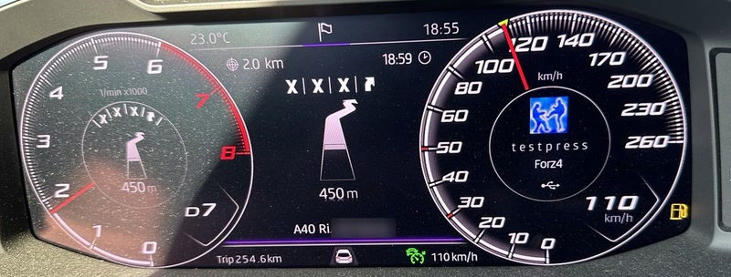 | 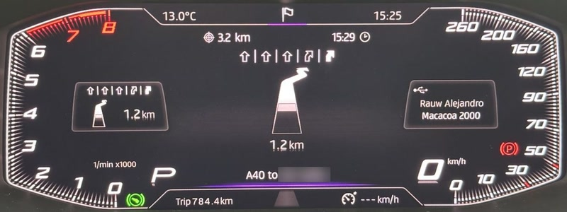 |

#### Side streets

- Turn arrow also shows the side streets of the junction
- The info comes from the junction data CarPlay sends and gets converted

|                           CarPlay                            |                           Cluster                            |
| :----------------------------------------------------------: | :----------------------------------------------------------: |
| 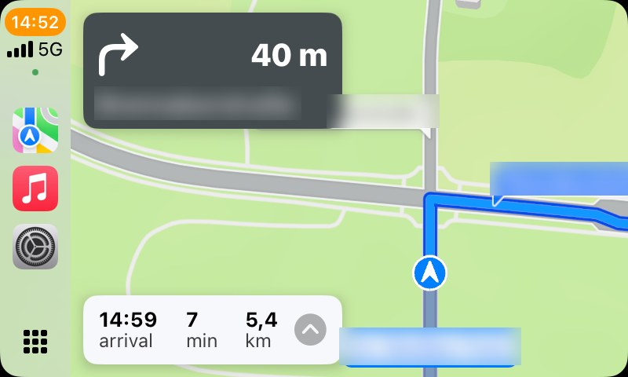 | 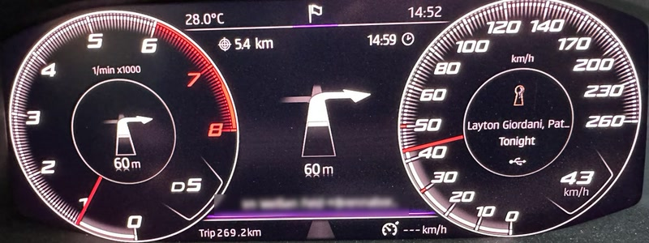 |

|                           CarPlay                            |                           Cluster                            |
| :----------------------------------------------------------: | :----------------------------------------------------------: |
| 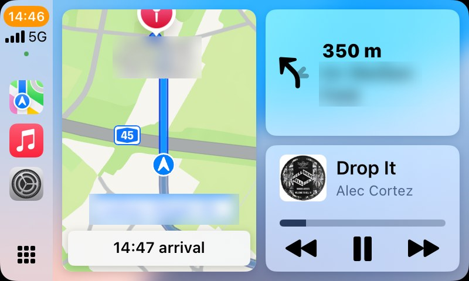 | 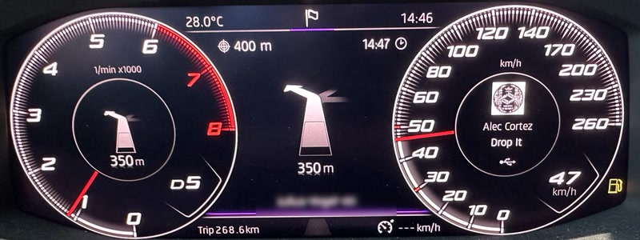 |

### Telephony

- Same features as a Bluetooth phone (except caller picture)
- In the telephony menu:
  - recently called list (up to 12)
    - numbers callable from the cluster
    - combined call dates
  - battery state
  - native CarPlay icon in front of the "Apple CarPlay" device name
- While calling:
  - call duration behind the caller name
  - mute and hold buttons available

| 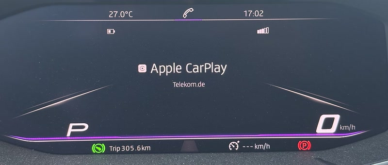 |
| :----------------------------------------------------------: |

### Settings menu

- A custom settings page in HMI, replacing the stock Full-Link/Smartphone config menu
- With options to enable parts of the patch

### Song info instead of "USB"

- The media info box of the navigation map and the car menu on the main screen
- Shows artist, album and title instead of just "USB"
  - Currently displayed without any media source

| 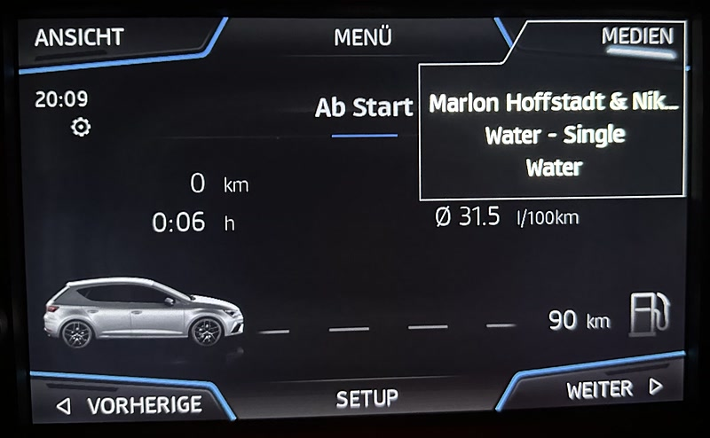 |
| :----------------------------------------------------------: |

### Real phone name in Full-Link/Smartphone menu

- The Full Link device list shows the real name of your iPhone instead of just "iPhone"
- With 2 or more iPhones every entry keeps the name of its own phone, so you can tell them apart. Two phones connected at the same time isn't tested yet
- A phone that hasn't been connected yet stays "iPhone" until it has been connected once

| 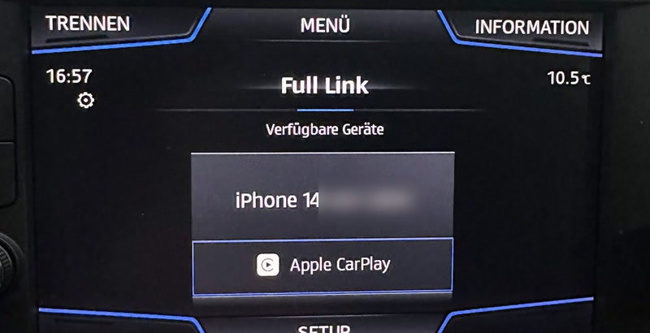 |
| :----------------------------------------------------------: |

### Volume numbers

- The volume popup on the head unit shows the volume as a number (0 to 30) right next to the bar
- The stock Seat popup only has the bar
- Can be switched off in the settings menu

| 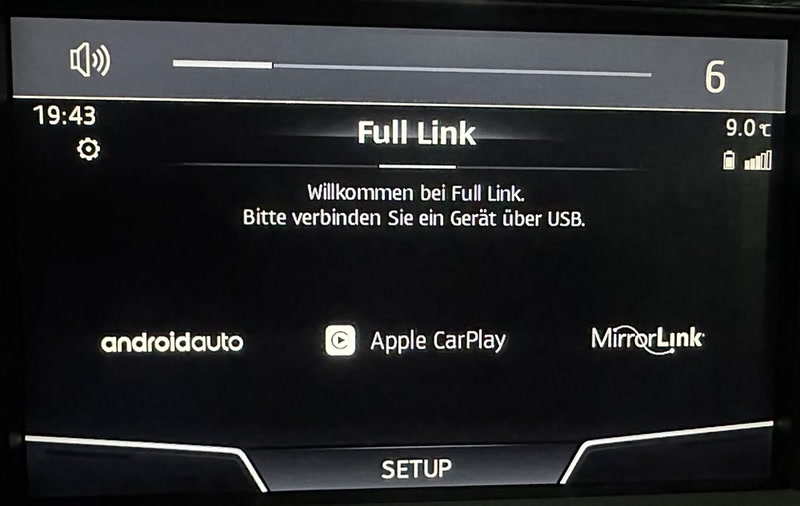 |
| :----------------------------------------------------------: |

### Resync library

- A small additional library which throttles the location packet spam from HU to iPhone, which otherwise causes random crashes (even with no patch enabled)

### Ambient light

- The ambient light follows the most dominant color of the current album cover
- Green color during calls

### Display resolution

- Can be set to 100, 105, 110, 115, 120 or 125 %
- Only for iOS 26 and newer
  - iOS 18 and older don't have smart display scaling

|                    iOS 18, 100 % (stock)                     |                    iOS 26, 100 % (stock)                     |
| :----------------------------------------------------------: | :----------------------------------------------------------: |
| 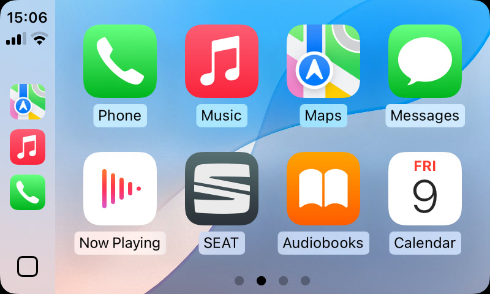 | 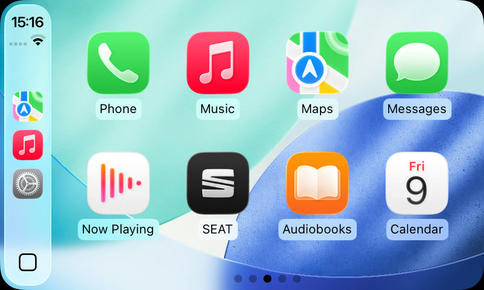 |

|                        iOS 26, 110 %                         |                        iOS 26, 115 %                         |
| :----------------------------------------------------------: | :----------------------------------------------------------: |
| 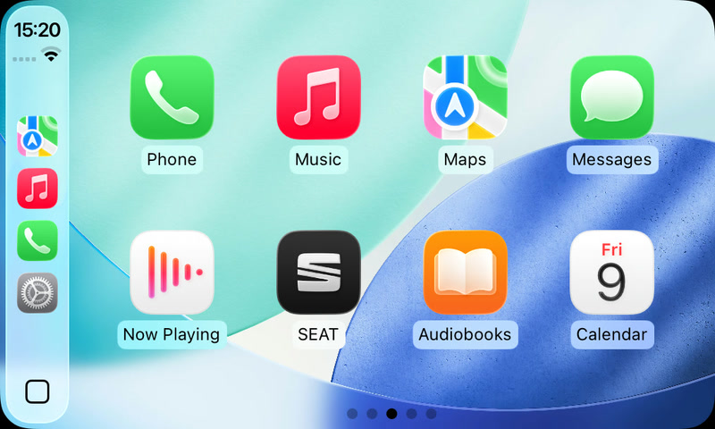 | 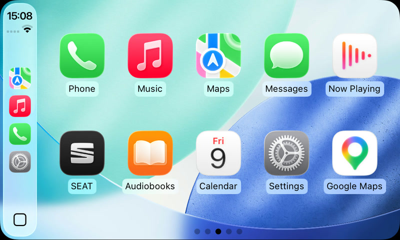 |

|                      Now Playing, 100 %                      |                      Now Playing, 115 %                      |
| :----------------------------------------------------------: | :----------------------------------------------------------: |
| 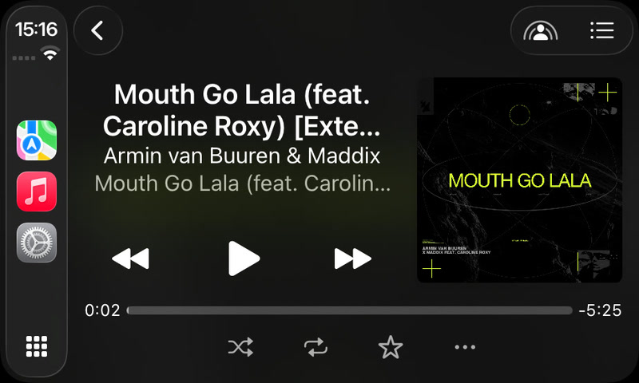 | 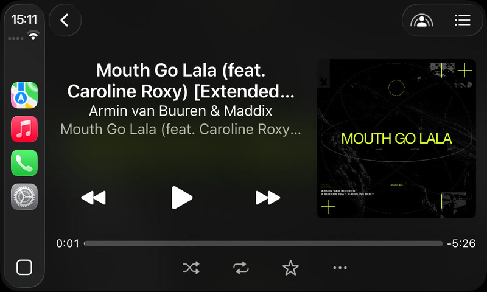 |

### Front PDC view not blocking CarPlay with blackscreen

- CarPlay stays visible next to the small front PDC view window
- Sensors, rear camera and the RVC PDC screen stay stock

| 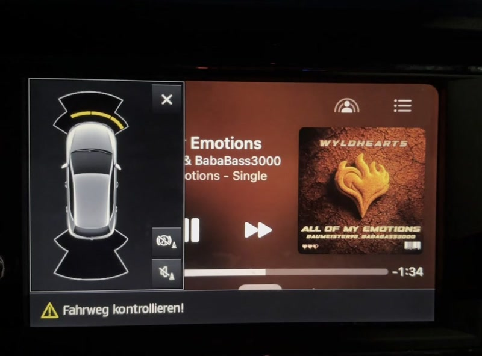 |
| :----------------------------------------------------------: |

### Spatial Audio / Dolby Atmos Surround Sound

- Apple Music in Atmos over CarPlay, decoded on the head unit and mixed down to the stereo pair
- Using all available 6 channels for an external MOST amp
- With selectable sound modes
- Work in progress

## CarPlay map in the Virtual Cockpit (paid solution)

CarPlay maps right in the Virtual Cockpit. Apple Maps or Google Maps as a second CarPlay screen in the Virtual Cockpit. The main patch remains free and updated for media and some other stuff in the future.

### Features

- Zoom with the steering wheel
- Cycle through chosen layouts
  - Map area, cluster layout, turn cards, lanes and arrival times are set individually for every cluster layout
- Auto light and dark mode
- Turn arrow and lanes keep running natively
- Speed signs, stop signs, traffic lights, traffic jams and road hazards supported (Some features are exclusive to Apple Maps)
- Successfully tested with Apple Maps, Google Maps, Waze, Pelican, Blitzer.de PRO (+ more supported apps)
- Supports Liquid Glass for iOS 26+
- Optimized for daily driving
- Option to turn off maps, to reduce load on the iPhone
- Works wirelessly with some third-party dongles (e.g. Carlinkit 5.0)
- Comes bundled with this main patch + more features for a full CarPlay integration

Made individually, will not be published here. Shoot me a DM on [Telegram](https://t.me/lelon99).

Sneak peeks:

|                  Analog gauges, Apple Maps                   |                  Analog gauges, Google Maps                  |
| :----------------------------------------------------------: | :----------------------------------------------------------: |
| 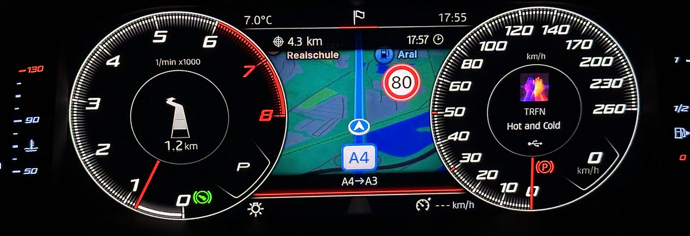 | 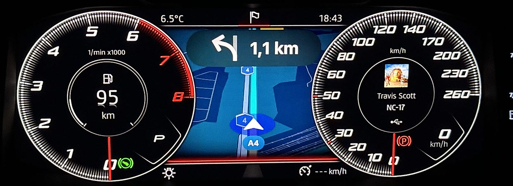 |

|                    Fullscreen, Apple Maps                    |                   Fullscreen, Google Maps                    |
| :----------------------------------------------------------: | :----------------------------------------------------------: |
| 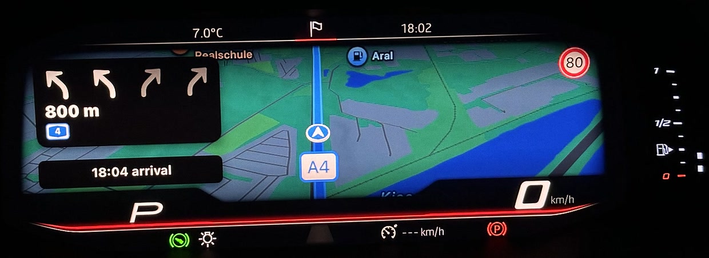 | 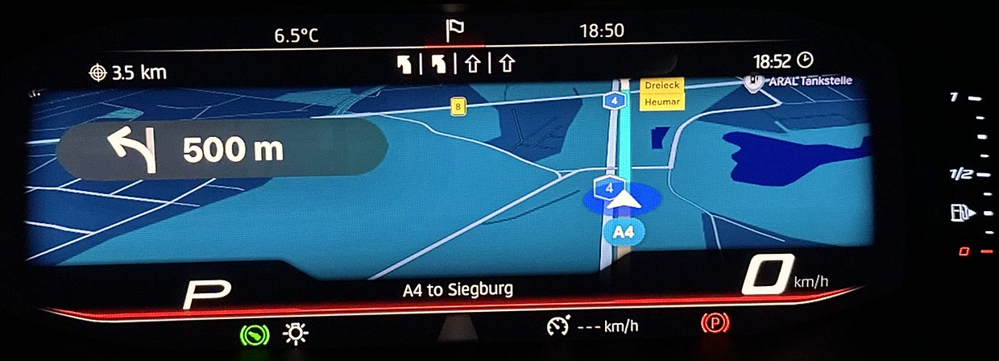 |

|                      Cupra layout, Waze                      |                   Cupra layout, Apple Maps                   |
| :----------------------------------------------------------: | :----------------------------------------------------------: |
| 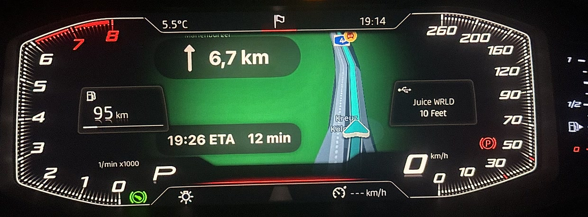 | 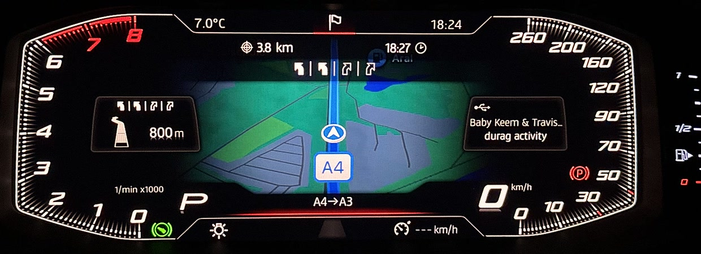 |

|            Analog gauges, alternative Google Maps            |       Option to turn off maps to reduce load on iPhone       |
| :----------------------------------------------------------: | :----------------------------------------------------------: |
| 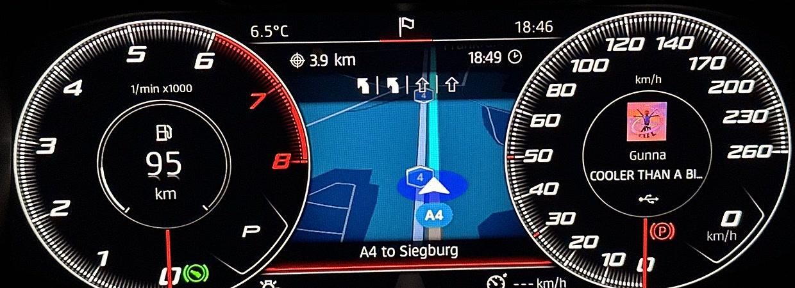 | 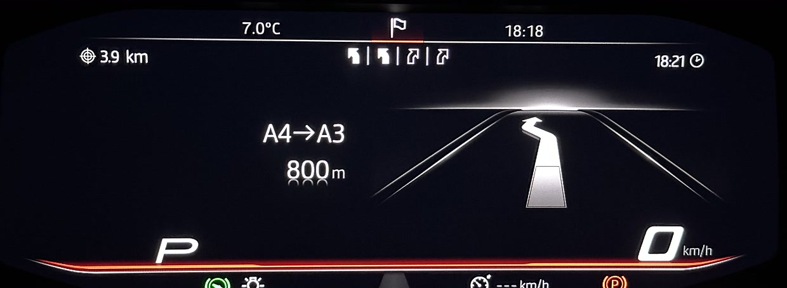 |
